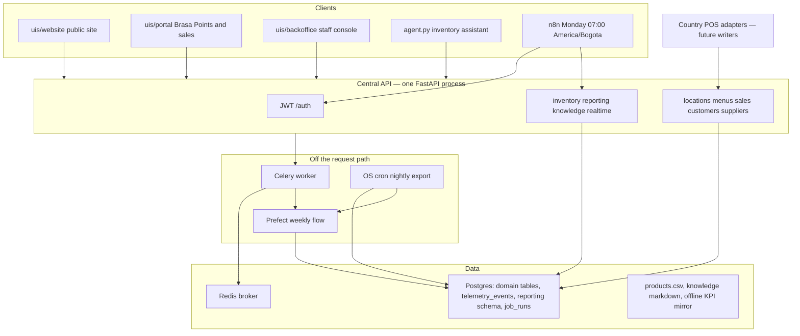
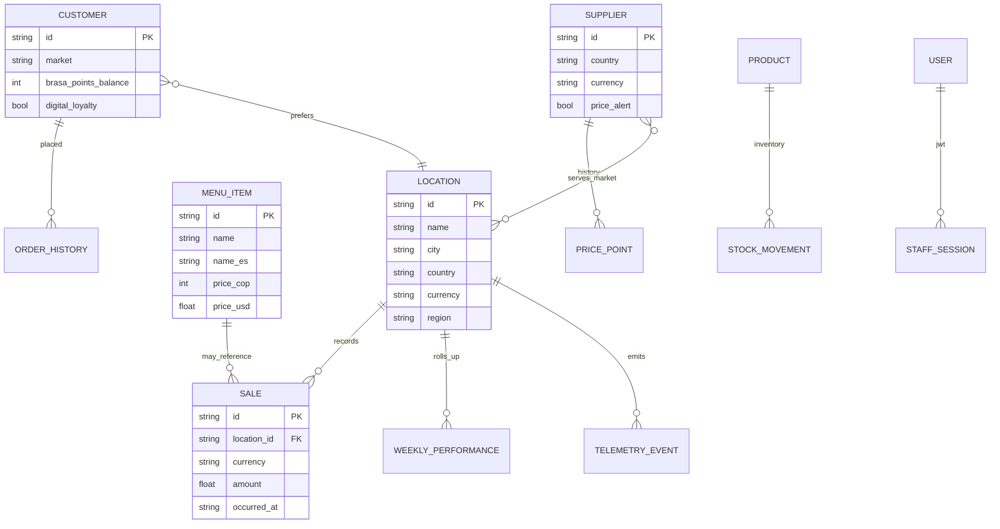

# Brasaland backend architecture proposal

**Audience:** Nicolás Park (Technology, Medellín) and Brasaland Digital.
**Company:** Brasaland — grilled food, founded 2008 in Medellín, 14 company-owned restaurants in Colombia and Florida, about 115 people, about USD 6 million annual revenue. Headquarters in Medellín; Miami coordinates Florida. CEO Mariana Restrepo.
**Source of truth:** root `CONTEXT.md`. This document maps that briefing onto the existing monorepo. It does not introduce another company, another repository, or a second application tree.
**Status:** proposal for the backend that this checkout is already growing. Seeded routes exist. Live POS, live invoices, a digital Brasa Points wallet, and the People portal are still ahead.

Department needs this proposal serves:

| Department | Lead | Need this architecture must carry |
| --- | --- | --- |
| Restaurant Operations | Felipe Guerrero | Sales per location in COP and USD, ingredient visibility, alert when an open location has no sales |
| Procurement and Suppliers | Lucía Fernández | About 20 suppliers, price history and alerts, consolidated purchasing across both markets |
| Marketing and Digital Experience | Camila Ospina | Customer CRM, order history, Brasa Points (today: physical stamp cards) |
| People and Culture | Ashley Turner | HR portal, onboarding, KPIs by country (later phase on the same API) |
| Training and Quality Standards | Jake Morrison | Same recipes in every kitchen; searchable standards; later, a push to all 14 locations |
| Technology | Nicolás Park | One central API for locations, menus, sales, customers, and suppliers; telemetry; a pipeline into operations, marketing, and finance |
| Executive Direction | Mariana Restrepo | Chain sales in USD and COP, a natural-language assistant, a report every Monday at 07:00 America/Bogota |

---

## 1. Decision

Brasaland Digital keeps **one FastAPI process** as the central API and adds capability by **router**, not by a new service per department.

```text
uvicorn api.app:app
        └── loads services/api/app.py
```

Heavy work stays off the request path: Celery + Redis for the weekly ETL enqueue, Prefect for the location-week transform, OS cron for the nightly telemetry copy, and n8n for Monday delivery. Analytical tables live in a `reporting` schema. Engineering events stay in `public.telemetry_events`. Staff and guest interfaces in `uis/` call this API. They do not own business rules.

That shape matches a two-person technology team, two countries, and a chain that still runs on spreadsheets and two POS systems. A microservice per noun would split COP/USD rules, JWT, and the 14-location roster across deploys Nicolás cannot staff.

---

## 2. Problem the backend has to close

`CONTEXT.md` describes a profitable chain run with single-restaurant tools:

- Each of the 14 kitchens orders ingredients by WhatsApp or phone, with no shared stock picture.
- Colombia and Florida use different point-of-sale terminals. There is no internal API and no consolidated telemetry.
- Brasa Points is a physical stamp card. About 60% of guests do not use it, so Marketing has almost no customer record.
- Leadership receives Tuesday PDFs. Mariana cannot answer “how much did Florida sell this week?” or “which location has the highest average ticket?” without a phone call.
- Recipe and procedure updates take days to reach both languages and all kitchens.

The backend’s job is to become the system of record those questions read, while the brand constraint stays intact: the same dishes and presentation in Medellín and Miami.

---

## 3. What this monorepo already runs

The proposal extends this checkout. It does not replace it.

| Concern | Where it lives today | Persistence today |
| --- | --- | --- |
| HTTP entry | `api/app.py` → `services/api/app.py` | Process |
| Locations, menus, sales, customers, suppliers | Routers in `services/api/` | In-memory seeds (14 locations, chain menu, tickets, CRM rows, about 20 suppliers) |
| Inventory | `services/api/inventory.py` | `products.csv` |
| Staff identity | `services/api/users.py`, `services/api/auth.py` | SQLite `data/company_api.db`; JWT (HS256, `JWT_SECRET_KEY`) |
| Weekly cost and waste | `data/process/location_kpis.py`, `data/pipelines/pipeline.py`, `services/reporting/` | `reporting.weekly_location_performance` (Supabase when configured; offline mirror otherwise) |
| Async ETL trigger | `POST /reporting/pipeline-runs` → Celery `services.tasks.run_weekly_pipeline` | Redis broker; dead letters in SQLite |
| Nightly copy of telemetry | `scripts/nightly_export.py`, `services/job_runner.py` | `public.telemetry_events` read; status in `public.job_runs`; cron `0 2 * * *` America/Bogota |
| Monday leadership delivery | `workflows/brasaland-monday-leadership-report.n8n.json` | Reads the reporting API; sends mail/Slack when credentials exist |
| Standards Q&A | `POST /knowledge/query` (`services/knowledge/routes.py`) | `docs/company-knowledge-base/`; local embeddings by default |
| No-sales alert | `GET /realtime/ops-alerts/stream` | In-process SSE; `POST /sales` calls `record_sale` |
| Guest and staff UIs | `uis/website`, `uis/backoffice`, `uis/portal` | Call the API or typed fixtures |
| Inventory assistant | Root `agent.py` | Manual Groq tool loop; no agent framework |

OpenAPI coverage for Technology’s five nouns is present on this app, together with inventory, reporting, knowledge, and the realtime stream. That coverage is a **seeded snapshot**. It is not a live POS feed, a live invoice feed, or a digital loyalty wallet (`digital_loyalty` stays false on customer rows).

Detail for graders and operators already lives beside this proposal:

- `docs/central-api.md`
- `docs/knowledge-rag.md`
- `docs/realtime-no-sales.md`
- `data/pipelines/PIPELINE_DESIGN.md`
- `workflows/README.md`

---

## 4. Target architecture



### Boundaries

| Boundary | Rule |
| --- | --- |
| One writer of domain truth | The central API. UIs, n8n, and the inventory agent are clients. |
| One roster | Every `location_id` is a `Location.id` from the 14-site roster (`co-med-centro` … `us-jacksonville`). Fixture labels such as `miami-downtown` are invalid. |
| Money | Colombia stores COP. Florida stores USD. Chain views may show both. An illustrative 4,000 COP per USD factor exists only so a dashboard can print the other currency. It is not a treasury rate. |
| Time | Chain week is `[Monday 00:00, next Monday 00:00)` America/Bogota. Location opening hours use America/Bogota in Colombia and America/New_York in Florida. |
| Telemetry vs reporting | `public.telemetry_events` is the append-only event log. `reporting.weekly_location_performance` is the weekly grain. `GET /telemetry/report` stays the engineering reader and does not serve Mariana’s KPIs. |
| Pipelines vs HTTP | `data/pipelines/` does not import `services/reporting/`. The HTTP shell imports the pipeline. |
| Secrets | `.env` holds `GROQ_API_KEY`, `JWT_SECRET_KEY`, `DATABASE_URL`, Supabase keys, and staff passwords for n8n. None of those values belong in git. |

---

## 5. Component map inside the monorepo

New backend code stays in the folders that already exist. A new top-level application is out of scope.

| Path | Responsibility |
| --- | --- |
| `api/app.py` | Compatibility entry so `uvicorn api.app:app` loads the central app |
| `services/api/` | Routers and Pydantic models for the five Technology nouns, inventory, users, and the no-sales channel |
| `services/reporting/` | `GET /reporting/weekly-location-performance`, `POST /reporting/pipeline-runs` (202 + `task_id`), run status |
| `services/knowledge/` | `POST /knowledge/query` |
| `services/celery_app.py`, `services/tasks.py`, `services/dead_letter.py` | Queue, retries, dead letters |
| `services/job_runner.py` | `public.job_runs` state machine for background jobs |
| `data/process/` | Pure transforms and the RAG index. Tests call these without HTTP |
| `data/pipelines/` | Prefect orchestration and reporting DDL |
| `data/raw/` | Optional landing files. The weekly flow reads the database |
| `data/eval/` | Hand-calculated fixtures for the 14 location ids |
| `workflows/` | n8n export for Monday delivery |
| `infra/cron/` | Nightly export crontab, outside the API process |
| `agents/`, `agent.py` | Assistants. The root agent is the inventory loop. Mariana’s sales assistant is a later agent that calls the API with tools, still without an agent framework unless a later milestone says otherwise |
| `uis/website` | Public corporate site |
| `uis/backoffice` | Staff session, locations, inventory, Monday report, live no-sales banner |
| `uis/portal` | Guest Brasa Points lookup and operations sales in COP and USD |
| `uis/web` | Incident HTML only. Marketing does not publish here |
| `docs/` | This proposal and the cross-cutting guides |

---

## 6. Domain model

The five nouns are the core. Inventory, telemetry, and the weekly report hang off `location_id`.



### Locations

Fourteen company-owned sites. Eight Colombia / COP, six Florida / USD. The API field `region` is the operating market label (`Colombia` or `Florida`). The reporting row stores `country` and `currency`, not `region`.

| `location_id` | Market | Currency |
| --- | --- | --- |
| `co-med-centro`, `co-med-elpoblado`, `co-bog-chapinero`, `co-bog-norte`, `co-cali-norte`, `co-barranquilla`, `co-cartagena`, `co-pereira` | Colombia | COP |
| `us-mia-brickell`, `us-mia-downtown`, `us-orlando`, `us-tampa`, `us-ftlauderdale`, `us-jacksonville` | Florida | USD |

### Menus

One chain catalogue. The same item ids in every kitchen (Training). Each item carries `price_cop` and `price_usd`, Spanish and English names, and allergens from `docs/company-knowledge-base/brasaland-menu-allergens.en.md`. Menu reads are public so the website and kitchens can show the card without a staff token.

### Sales

A sale is one ticket: `location_id`, `amount` in that location’s currency, `occurred_at`. `POST /sales` rejects a currency that is not the location’s own (COP restaurant with USD is 400). Overview endpoints add chain totals in both currencies for Mariana and per-location rows for Felipe. `amount_cop` / `amount_usd` on a ticket are display conversions, labeled as illustrative.

### Customers

CRM rows for Camila: name, market, preferred location, preferences, order history, `brasa_points_balance`, tier (Bronze 0–19, Silver 20–49, Gold 50+). Points rule from the knowledge base: 1 point per 10,000 COP or per 10 USD. `loyalty_medium` is `physical_stamp_card` and `digital_loyalty` is false until a later milestone issues a real wallet. The portal may read these rows when `BRASALAND_DATA_SOURCE=live`.

### Suppliers

About 20 suppliers split across Colombia and Florida. Categories: proteins, vegetables and fruit, sauces, beverages, packaging, cleaning. Each supplier has a currency, a price history, and a `price_alert` when the latest price moved. Invoices are not ingested yet. The weekly price-alert KPI counts telemetry events; it does not invent a second supplier key.

### Inventory and orders

Live stock is `products.csv` (`product_id`, `name`, `quantity`, `unit`) behind `/inventory`. Declared SQLModel types `Product`, `InboundOrder`, and `OutboundOrder` describe the order shape the pipeline expects (`INBOUND` / `OUTBOUND`). The weekly rollup sums `event_payload.cost` on `inbound_order_created` and `stock_waste_registered`. It does not group by product.

### Weekly performance

One row per `(location_id, week_start)` in `reporting.weekly_location_performance`:

| KPI | Column | Source event |
| --- | --- | --- |
| Purchase cost | `total_purchase_cost` | `inbound_order_created` |
| Waste cost | `total_waste_cost` | `stock_waste_registered` |
| Waste ratio | `waste_ratio` | waste / purchase, else 0, 4 decimal places |
| Stockout frequency | `stockout_events_count` | `stock_threshold_triggered` |
| Price alert frequency | `price_alert_events_count` | `ingredient_price_variance_detected` |

Upsert on `(location_id, week_start)` so Monday can re-run without duplicating a kitchen. Costs stay in the location currency. The pipeline does not average those ratios into a monthly rate.

### People (later, same API)

Ashley’s portal (holiday requests, absence, onboarding, turnover and vacancy time by country) is a future router on this app, scoped by country. It does not become a separate HR service. Labour-law differences between Colombia and Florida stay in policy tables, not in forked codebases.

---

## 7. API surface

Interactive docs: `http://127.0.0.1:8000/docs` after `uvicorn api.app:app`.

| Area | Auth | Representative routes | Caller |
| --- | --- | --- | --- |
| Menus | Public | `GET /menus`, `/menus/catalogue`, `/menus/{item_id}` | Website, kitchens, Training |
| Locations | Bearer | `GET /locations`, `/locations/overview` | Backoffice, Operations |
| Sales | Bearer | `GET /sales`, `/sales/overview`, `/sales/alerts`, `POST /sales` | Felipe, Mariana, portal `/ops/sales`, no-sales hook |
| Customers | Bearer | `GET /customers`, `/customers/{id}` | Camila, portal `/points` |
| Suppliers | Bearer | `GET /suppliers`, `/suppliers/overview` | Lucía |
| Inventory | Bearer on staff flows | `GET/POST /inventory`, `PATCH /inventory/{id}`, `GET /inventory/alerts` | Kitchens, `agent.py` |
| Reporting | Bearer | `GET /reporting/weekly-location-performance`, `POST /reporting/pipeline-runs`, `GET /tasks/{task_id}` | Monday report, n8n |
| Knowledge | As mounted | `POST /knowledge/query` | Training, standards questions |
| Realtime | Bearer | `GET /realtime/ops-alerts/stream` | Backoffice `/accessible` |
| Auth | Public login | `POST /auth/register`, `/auth/login`, `/auth/token`; `GET /auth/me` | Staff console, n8n |

Errors use a JSON envelope (`status`, `code`, `message`, `detail`) for 400, 404, 422, and 500. Responses omit tracebacks, connection strings, API keys, and host paths. Unknown ids are 404. Missing tokens are 401.

`POST /reporting/pipeline-runs` returns **202** and a `task_id`. The worker is a separate process. The API only enqueues.

### Future routes, still on this app

| Need | Proposed route shape | Phase |
| --- | --- | --- |
| Intelligent ingredient order from history + stock | `POST /procurement/suggested-orders` reading sales history and `/inventory` | After sales leave memory |
| Supplier invoice intake | `POST /suppliers/{id}/invoices` feeding price history | After the supplier table is durable |
| Digital Brasa Points earn/redeem | `POST /customers/{id}/loyalty/earn` once `digital_loyalty` can be true | Marketing milestone; stamp-card reads stay until then |
| Recipe push to 14 kitchens | `POST /menus/{id}/publications` plus the knowledge index | Training |
| HR by country | `GET /people/kpis?country=` | People |
| Natural-language chain sales | Agent tools over `GET /sales/overview` | Executive assistant |

---

## 8. Data flows

### 8.1 Ticket to dashboard

1. A location records a sale (`POST /sales` today; a POS adapter later).
2. The ticket is stored in the location currency.
3. `record_sale` clears a no-sales alert for that `location_id` when the sale falls inside opening hours (11:00–22:00 local, quiet window default 30 minutes).
4. `GET /sales/overview` and portal `/ops/sales` show per-location amounts and chain totals in COP and USD.
5. The SSE stream on `/accessible` updates Felipe’s banner without a reload.

A location with no sale history stays silent so the alert does not fire for all 14 sites before a POS exists. The simulator exists for graders.

### 8.2 Monday operations and finance

1. During the week, location events land in `public.telemetry_events` (purchase, waste, stockout, price alert).
2. Nightly, cron `0 2 * * *` America/Bogota runs `scripts/nightly_export.py`. It writes `public.job_runs` (`pending` → `processing` → `completed` or `failed`). A `processing` row is the lock. A completed row for that date skips a duplicate.
3. The Prefect flow `brasaland_weekly_performance_pipeline` runs three stage subflows: extract, transform (`data/process/location_kpis.py`), load. Optional eval is its own subflow.
4. Load upserts `reporting.weekly_location_performance`.
5. Monday 07:00 America/Bogota, n8n logs into the API, calls `GET /reporting/weekly-location-performance`, and delivers COP and USD leadership copy (email, Slack, CSV). The workflow does not enqueue the pipeline. The week must already be loaded.
6. The backoffice page “Monday weekly ops & finance report” reads the same endpoint for Mariana, Felipe, and Lucía.

### 8.3 Standards question

`POST /knowledge/query` retrieves chunks from the company knowledge base (allergens, waste, ordering, Brasa Points) and answers only from those chunks, with citations. Default embeddings are local. `BRASALAND_RAG_BACKEND=qdrant` and `BRASALAND_RAG_LLM=openai` are optional. This route is the Training search. It is not Mariana’s sales assistant.

### 8.4 Inventory assistant

`python agent.py` starts only after the API is up. The loop is plain Python (observe, think, act, update) using the Groq client. Tools map to `/inventory`. Turns append to `conversation_log.csv`.

---

## 9. Persistence plan

Today’s seeds prove the contracts. The next backend step is durability, not a new framework.

| Data | Now | Target |
| --- | --- | --- |
| Five nouns | Python lists in the routers | Postgres tables with the same Pydantic field names, loaded by the same routes |
| Staff users | SQLite `data/company_api.db` | Same SQLite in local dev; Postgres when `DATABASE_URL` is the shared database |
| Stock | `products.csv` | Remain the live stock file until an explicit migration; SQLModel order tables are the declared shape, not a second live writer |
| Events | `public.telemetry_events` | Unchanged append-only log |
| Weekly KPIs | `reporting` schema | Unchanged grain and upsert key |
| Job status | `public.job_runs` | Unchanged state machine |
| Queue | Redis | Unchanged |
| Knowledge files | Markdown in `docs/company-knowledge-base/` | Remain the authored source; the index is derived |

Supabase is the hosted Postgres already used for telemetry and reporting. Domain tables should land there as migrations under the data/pipeline SQL style (`data/pipelines/*.sql`), applied deliberately. Router modules keep validating currency, location, and loyalty rules so a raw SQL client cannot bypass them.

Idempotency rules that must survive the move:

- Weekly KPI upsert on `(location_id, week_start)`.
- Nightly job: one `processing` lock per job; a `completed` pair `(job_name, target_date)` does not run again.
- `POST /sales` from a POS adapter should accept an external ticket id so a retried terminal post does not double-count. That id is a field to add when the POS writer exists.

---

## 10. Authentication and authorization

| Principal | How they enter | What they may do |
| --- | --- | --- |
| Guest | No token | Public menu; corporate site; portal points lookup through the portal server, which holds `BRASALAND_API_TOKEN` server-side |
| Staff | `POST /auth/login` → Bearer JWT, stored in the backoffice session | Locations, sales, customers, suppliers, inventory, reporting, realtime alerts, own profile |
| First registered user | Register | Admin flag for user administration |
| n8n | `BRASALAND_STAFF_EMAIL` / `BRASALAND_STAFF_PASSWORD` at run time | Login, then read the weekly report |
| Inventory agent | Calls the API on localhost | Inventory tools only |

Tokens expire (`ACCESS_TOKEN_EXPIRE_MINUTES`, default 30). `JWT_SECRET_KEY` must be stable across reloads or every restart logs staff out. Passwords are bcrypt hashes. The backoffice clears the session on 401.

Authorization to add when nouns become durable:

- Role claims on the JWT (`ops`, `procurement`, `marketing`, `people`, `executive`, `admin`) so Lucía’s invoice write is not available to every kitchen login.
- Location scope later, if a supervisor should see one site. Felipe and Mariana stay chain-wide.
- Menus stay public. Mutating a menu (recipe push) requires a Training or admin role.

---

## 11. Processes and schedules

Four clocks, on purpose. Folding them into the API process would tie a long ETL or a crashed cron to request latency.

| Clock | Process | Schedule | Failure |
| --- | --- | --- | --- |
| HTTP | `uvicorn api.app:app` | Always on | Structured JSON; external calls fail closed (503) |
| Queue | Celery worker | On demand from `POST /reporting/pipeline-runs` | 3 retries, exponential countdown; then SQLite dead letter |
| Nightly landing | OS cron + `scripts/nightly_export.py` | 02:00 America/Bogota | `job_runs.status=failed` with `error_message`; row does not stay `processing` |
| Monday delivery | n8n | 07:00 America/Bogota Monday (`0 7 * * 1`) | Failure file plus optional email/Slack; workflow stays inactive until credentials exist |

Flower (`localhost:5555`) is the local view of queued, running, and finished Celery tasks. It is an operator tool, not a product surface.

---

## 12. Multi-market rules

These rules are part of the architecture. A single-currency or single-timezone shortcut fails the briefing.

- **Currency.** Persist the location currency. Show COP and USD together on executive and operations views. Keep purchase and waste costs unconverted inside `reporting.weekly_location_performance`.
- **Country.** People KPIs, supplier lists, and sales filters segment Colombia and Florida (United States).
- **Language.** Menu items already carry `name` and `name_es`. Knowledge articles can grow a Spanish twin. One base language is acceptable; the schema must not assume English-only fields.
- **Calendar.** Chain reporting uses America/Bogota, including the Monday 07:00 send. Florida opening-hour alerts use America/New_York. Bogotá has no daylight saving; New York does. The two clocks stay explicit.
- **Scale.** Queries and alerts iterate the 14 ids. Empty-history behavior is defined so a new integration does not page all kitchens.

---

## 13. Security and failure behavior

- Secrets stay in the environment. Client JSON never echoes DSNs, keys, or filesystem paths.
- Upload and incident paths resolve inside the repository root.
- CORS allows the local website (`5173`) and backoffice (`5174`) origins used in development.
- External dependencies (language model, Qdrant, Supabase) fail as a controlled unavailable response. A missing key does not invent an answer.
- The knowledge answer refuses questions the chunks do not support.
- Pipeline validation writes `data/eval/last_validation.json` so a bad week is visible before it is treated as leadership truth.
- n8n placeholders ship without live SMTP, Slack, or staff passwords.

---

## 14. Delivery sequence

Work continues in this repository, in this order. Each step names a `CONTEXT.md` department.

1. **Durable nouns (Technology).** Move locations, menus, sales, customers, and suppliers from in-memory seeds to Postgres without changing the published JSON. Re-run `.agents/skills/verify-brasaland-api` and `tests/test_central_api_domains.py`.
2. **POS writer (Operations + Technology).** One adapter per country posts `POST /sales` with the location currency and an external ticket id. The no-sales stream starts reflecting real quiet periods.
3. **Executive sales assistant (Executive).** A tool-using loop over `GET /sales/overview` that can answer Florida-this-week and highest average ticket in natural language. Separate from `POST /knowledge/query`.
4. **Ordering suggestion (Operations + Procurement).** Suggested purchase quantities from sales history and stock, with supplier price alerts Lucía already sees on `/suppliers`.
5. **Digital Brasa Points (Marketing).** Earn and redeem only after the stamp-card balance has a durable ledger. Until that ships, `digital_loyalty` remains false.
6. **Recipe publication (Training).** Version a menu item and notify all 14 locations from one write.
7. **People portal (People).** Country-segmented HR KPIs on the same API and a backoffice section.

Monday delivery, the weekly KPI table, the public menu, the seeded CRM, and the live no-sales channel stay in place through these steps.

---

## 15. Risks

| Risk | Why it matters | Mitigation in this design |
| --- | --- | --- |
| Two POS systems drift | Colombia and Florida tickets would not match overview totals | One sale schema; currency checked against the location; external id for retries |
| Illustrative FX treated as accounting | COP and USD totals would be “converted” in finance | Reporting KPIs stay in location currency; FX fields are labeled illustrative |
| Seeds mistaken for production | A dashboard would look done while WhatsApp ordering continues | Source strings on payloads; `digital_loyalty=false`; Progress.md states the gap |
| Pipeline and HTTP coupled | A slow Monday load would block staff logins | 202 + worker; n8n reads a finished table |
| Alert noise before go-live | 14 false quiet alarms | No history means no alert |
| Secret in a workflow export | Staff or SMTP credentials in git | n8n JSON uses env names; validation script checks secret patterns |
| Split brain on location ids | Telemetry that uses `medellin-centro` drops out of the rollup | Closed roster; failed joins must not default currency to USD |

---

## 16. How to read this against the running app

From the repository root, with dependencies installed and `JWT_SECRET_KEY` set:

```bash
uvicorn api.app:app --reload --host 127.0.0.1 --port 8000
```

Then confirm Technology’s list on OpenAPI (locations, menus, sales, customers, suppliers) plus inventory, and call the flows in `docs/central-api.md`, `docs/realtime-no-sales.md`, and `docs/knowledge-rag.md`.

This proposal is the map. The routers and pipelines already in the tree are the first slice of that map, still backed by seeds where a live store does not exist yet.
